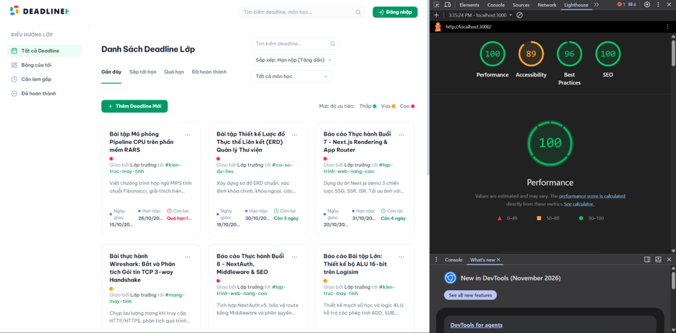

# Class Deadline Hub — Cổng Thông Tin Deadline Lớp Học

Dự án bài thực hành học phần **Lập trình Web Nâng cao (LTWNC)**.  
Ứng dụng xây dựng trên nền tảng **Next.js 16 (App Router)**, **TypeScript**, **Tailwind CSS**, và **Auth.js (NextAuth v5)**.
Link vercel: https://b23-dccc-072-ltwnc-th-03.vercel.app/
---

## 1. Hướng Dẫn Cài Đặt và Khởi Chạy

### Yêu cầu môi trường
- Node.js version 20+ LTS
- npm hoặc yarn/pnpm

### Các bước khởi chạy

1. **Cài đặt các gói phụ thuộc:**
   ```bash
   npm install
   ```

2. **Cấu hình biến môi trường (`.env.local`):**
   File `.env.local` đã được tạo sẵn tại thư mục gốc với nội dung:
   ```env
   AUTH_SECRET="43c773d29b3a9c93b4e0bedc551c77f2e93c857a8d5f5afac51fbfae26d19b67"
   NEXTAUTH_URL="http://localhost:3000"
   ```

3. **Chạy môi trường phát triển (Development):**
   ```bash
   npm run dev
   ```

4. **Biên dịch và chạy bản Production (Khuyên dùng để kiểm tra SEO & Lighthouse):**
   ```bash
   npm run build
   npm run start
   ```

---

## 2. Tài Khoản Kiểm Thử (Bắt Buộc Theo Đề Bài)

Hệ thống có sẵn nút điền nhanh tài khoản tại trang `/login`:

| Email | Mật khẩu | Vai trò (`role`) | Quyền hạn |
| :--- | :--- | :---: | :--- |
| `admin@ptit.edu.vn` | `admin123` | **`admin`** | Xem, Đánh dấu hoàn thành, Thêm deadline, Xoá deadline, Quản trị `/admin` |
| `sv@ptit.edu.vn` | `sv123456` | **`user`** | Xem deadline, Đánh dấu hoàn thành tại `/dashboard` (Bị chặn khi vào `/admin` $\rightarrow$ chuyển hướng `/403`) |

---

## 3. Bảng Kết Quả `npm run build` và Lý Do Chọn Chiến Lược Render

### Kết quả Terminal khi chạy `npm run build`


### Bảng phân tích lý do chọn chiến lược cho từng route

| Route | Quyền truy cập | Chiến lược | Ký hiệu Build | Lý do kỹ thuật |
| :--- | :--- | :---: | :---: | :--- |
| `/` | Mọi người | **SSG** | `○` (Static) | Cổng Class Deadlines hiển thị trực tiếp danh sách bài tập (SaaS Dashboard); render tĩnh lúc build để tải tức thì từ CDN với TTFB tối thiểu. |
| `/subjects/[slug]` | Mọi người | **SSG** | `●` (SSG) | 4 môn học cố định kỳ này; sử dụng `generateStaticParams` để tạo sẵn file HTML tĩnh cho từng môn lúc build. Tối ưu SEO cho từng môn học. |
| `/deadlines` | Mọi người | **ISR (60s)** | `○` (Static 1m) | Trang danh sách tổng hợp deadline cần dữ liệu cập nhật theo chu kỳ mà không làm quá tải server; dùng `revalidate = 60` giúp dữ liệu cũ tối đa 60 giây. |
| `/deadlines/[id]` | Mọi người | **ISR (On-demand)** | `●` (SSG) | Sinh sẵn HTML lúc build bằng `generateStaticParams`, đồng thời làm mới ngầm tức thì (`revalidatePath`) ngay khi Lớp trưởng thêm hoặc xoá bài tập. |
| `/dashboard` | Đã đăng nhập | **SSR** | `ƒ` (Dynamic) | Trang cá nhân hoá của từng sinh viên (danh sách bài tập đã nộp / chưa nộp riêng biệt theo `userId`); bắt buộc render ở server mỗi request theo cookie phiên. |
| `/admin` | Chỉ `admin` | **SSR** | `ƒ` (Dynamic) | Yêu cầu kiểm tra quyền hạn Lớp trưởng thời gian thực và hiển thị dữ liệu quản trị mới nhất; không được cache công khai. |

---

## 4. Kiểm Tra View-Source Trang Chi Tiết `/deadlines/1`

Mở trình duyệt truy cập `view-source:http://localhost:3000/deadlines/1` để xác nhận server trả về HTML đầy đủ nội dung (chứng minh tính năng SSR/SSG/ISR tối ưu SEO vượt trội so với React CSR thuần túy):

### Trích xuất thẻ `<head>` có đầy đủ Title, Meta, Canonical, OpenGraph và JSON-LD:
```html
<title>Báo cáo Thực hành Buổi 7 - Next.js Rendering &amp; App Router - Môn Lập trình Web nâng cao | Class Deadline Hub</title>
<meta name="description" content="Dựng dự án Next.js demo 3 chiến lược SSG, SSR, ISR. Tối ưu ảnh với next/image, sitemap và đo điểm Lighthouse."/>
<link rel="canonical" href="http://localhost:3000/deadlines/1"/>

<!-- Dynamic OpenGraph Tags -->
<meta property="og:title" content="Báo cáo Thực hành Buổi 7 - Next.js Rendering &amp; App Router | Deadline Hub"/>
<meta property="og:description" content="Hạn nộp: 06:59 31/10/2026 • Môn: Lập trình Web nâng cao"/>
<meta property="og:image" content="http://localhost:3000/deadlines/1/opengraph-image-104vc5"/>
<meta property="og:image:width" content="1200"/>
<meta property="og:image:height" content="630"/>

<!-- Structured Data (JSON-LD) BreadcrumbList -->
<script type="application/ld+json">
{
  "@context": "https://schema.org",
  "@type": "BreadcrumbList",
  "itemListElement": [
    { "@type": "ListItem", "position": 1, "name": "Trang chủ", "item": "http://localhost:3000" },
    { "@type": "ListItem", "position": 2, "name": "Danh sách Deadline", "item": "http://localhost:3000/deadlines" },
    { "@type": "ListItem", "position": 3, "name": "Báo cáo Thực hành Buổi 7 - Next.js Rendering & App Router", "item": "http://localhost:3000/deadlines/1" }
  ]
}
</script>
```

---

## 5. Điểm Số Đánh Giá Lighthouse



---

## 6. Trả Lời Câu Hỏi

### Câu hỏi 1: Vì sao /deadlines/[id] dùng ISR?

1. **Yêu cầu quan trọng về SEO và Trải nghiệm Người dùng (UX)**:
   - Trang chi tiết bài tập cần được lập chỉ mục bởi Googlebot và tạo ảnh xem trước (rich preview card) bắt mắt khi sinh viên chia sẻ liên kết lên Facebook, Zalo, Discord.
   - Nếu dùng **CSR (React thuần)**, trang trả về HTML rỗng, bot tìm kiếm có thể bỏ qua và người dùng mạng chậm phải chờ tải JS mới thấy được nội dung.
2. **Khắc phục nhược điểm của SSG thuần túy**:
   - Trong một kỳ học, bài tập liên tục được thêm mới, cập nhật tiêu chuẩn nộp hoặc dời hạn chót.
   - Nếu dùng **SSG thuần túy**, mỗi lần Lớp trưởng sửa một dòng mô tả hay thêm một deadline mới, quản trị viên sẽ phải chạy lại toàn bộ lệnh `npm run build` và deploy lại cả website (rất chậm và lãng phí tài nguyên máy chủ).
3. **Khắc phục nhược điểm của SSR thuần túy**:
   - Nếu dùng **SSR**, mỗi lần có sinh viên bấm xem bài tập, server lại phải giải mã request, đọc file JSON/CSDL và render lại HTML từ đầu. Vào giờ cao điểm (sát hạn nộp bài), hàng trăm sinh viên truy cập cùng lúc sẽ gây nghẽn server và tăng chỉ số TTFB (Time to First Byte).
4. **Giải pháp tối ưu từ ISR (Incremental Static Regeneration)**:
   - Các trang deadline được sinh sẵn file HTML tĩnh ngay lúc build bằng `generateStaticParams`.
   - Sinh viên truy cập nhận ngay file HTML từ CDN với tốc độ tức thì (LCP < 1s).
   - Khi Lớp trưởng thêm, sửa hoặc xoá bài tập, hệ thống kích hoạt **On-Demand Revalidation** thông qua `revalidatePath('/deadlines/' + id)` trong Server Action. Next.js sẽ tái tạo lại ngầm trang đó trong vài mili-giây mà **hoàn toàn không cần build lại toàn bộ website**.

---

### Câu hỏi 2: Nếu chỉ dùng Middleware để bảo vệ /admin thì có rủi ro gì?

Nguyên tắc vàng trong bảo mật ứng dụng web là **Bảo vệ đa tầng (Defense in Depth)**. Việc chỉ dựa duy nhất vào Middleware ở vòng ngoài tiềm ẩn các rủi ro nghiêm trọng sau:

1. **Server Action là Public HTTP POST Endpoints**:
   - Trong kiến trúc Next.js App Router, mỗi Server Action (như hàm `deleteDeadlineAction` hay `createDeadlineAction`) được đóng gói thành một endpoint HTTP POST độc lập.
   - Kẻ xấu hoàn toàn có thể dùng công cụ như Postman, curl hoặc viết script gửi request POST trực tiếp vào ID của action đó mà **không cần thông qua giao diện `/admin`**.
   - Nếu Server Action không tự gọi `auth()` và kiểm tra `can(role, action)` bên trong hàm, kẻ tấn công vẫn có thể xoá hoặc phá hoại dữ liệu lớp học dù họ không bao giờ mở trang `/admin`.
2. **Rủi ro cấu hình sai hoặc thiếu sót trong Matcher**:
   - Middleware dựa vào `config.matcher` (ví dụ `['/admin/:path*']`). Nếu lập trình viên cấu hình sơ suất (ví dụ: route group lồng nhau, query parameters, bypass bằng URL encoding, hoặc thêm route quản trị mới mà quên cập nhật matcher), request sẽ đi thẳng vào trang mà không bị Middleware chặn lại.
3. **Lỗ hổng bảo mật của Framework/Runtime**:
   - Thực tế đã có những lỗ hổng bảo mật cấp độ framework (CVE) cho phép bypass qua tầng middleware ở một số điều kiện routing đặc thù trước khi các bản vá được phát hành. Nếu tầng trong cùng (Page Component) không xác thực lại quyền, toàn bộ dữ liệu nội bộ sẽ bị lộ.
4. **Giới hạn của môi trường Edge Runtime**:
   - Middleware chạy trên Edge Runtime nhẹ, không thể kết nối tới cơ sở dữ liệu đầy đủ hoặc gọi các thư viện kiểm tra quyền hạn chuyên sâu. Middleware chỉ kiểm tra được cookie phiên thô (chữ ký token JWT). Nếu tài khoản admin vừa bị thu hồi quyền trong CSDL nhưng token chưa hết hạn, Middleware vẫn cho qua.
5. **Giải pháp chuẩn hóa đã triển khai trong đồ án**:
   - **Tầng 1 (Middleware)**: Chặn sớm unauthenticated request chuyển hướng `/login`, chặn sinh viên chuyển hướng `/403`.
   - **Tầng 2 (Page Server Component)**: Gọi lại `auth()` và kiểm tra vai trò `admin` trước khi nạp dữ liệu môn học vào HTML.
   - **Tầng 3 (Server Action)**: Kiểm tra `can(role, action)` và validate cấu trúc dữ liệu đầu vào bằng thư viện `zod` trước khi ghi vào file dữ liệu JSON.
   - **Tầng 4 (Data Layer)**: Xác thực tính toàn vẹn dữ liệu ở cấp độ đọc/ghi file.
